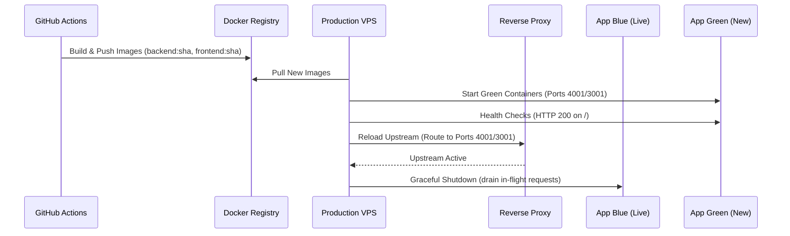

# Operational Runbook: Zero-Downtime Deployment & Rollback

**Platform:** Tsehafi Training Academy Management (TAM)  
**Architecture:** Next.js Frontend + NestJS Monolith + PostgreSQL 16  
**Pattern:** Blue/Green Zero-Downtime with Database Backward Compatibility

---

## 1. Pre-Deployment Verification Checklist
1. All unit and integration tests passing (`npm test && npm run test:e2e`).
2. Production build compiles cleanly (`npm run build`).
3. Database migrations follow the Expand/Migrate/Contract paradigm (no breaking column renames or instant drops in a single deploy).
4. Run full database backup before initiating deployment:
   ```bash
   ./scripts/backup-db.sh
   ```

---

## 2. Zero-Downtime Deployment Sequence



### Step 1: Run Database Migrations
Migrations execute before traffic switches:
```bash
npx prisma db push --skip-generate
psql -h localhost -U tsehafi -d tam_db -f prisma/rls_policies.sql
```

### Step 2: Deploy New Backend & Frontend Containers
Spin up Green instances on parallel ports, verify `/` health check, then reload Nginx upstream:
```bash
# Verify health
curl -f http://127.0.0.1:4001/
curl -f http://127.0.0.1:3001/

# Atomically switch Nginx
sudo ln -sf /etc/nginx/sites-available/tam-green.conf /etc/nginx/sites-enabled/tam.conf
sudo nginx -s reload
```

---

## 3. Instant Rollback Procedure

If error rate spikes (> 1% 5xx errors) or p95 response time exceeds 1,000 ms:

1. **Immediate Nginx Traffic Rollback (< 5 seconds):**
   ```bash
   sudo ln -sf /etc/nginx/sites-available/tam-blue.conf /etc/nginx/sites-enabled/tam.conf
   sudo nginx -s reload
   ```

2. **Verify Blue Health:**
   ```bash
   curl -f http://127.0.0.1:4000/
   curl -f http://127.0.0.1:3000/
   ```

3. **Database State Rollback (if migration occurred):**
   Restore from the pre-deploy backup snapshot using `./scripts/verify-restore.sh`.
