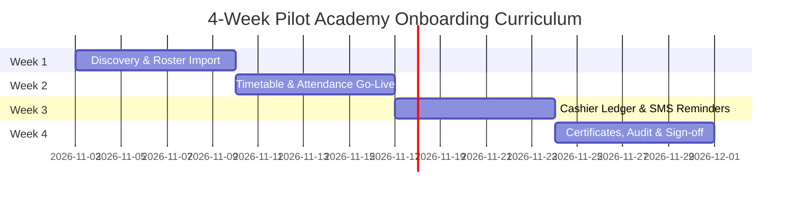

# Pilot Academy Onboarding Playbook: 4-Week Commercial Curriculum

**Audience:** Partner Academy Owners, Directors, Cashiers & Trainers in Addis Ababa  
**Objective:** Transition an academy from paper/Excel to 100% autonomous operation within 28 days  
**Target Pilot Cohort:** 3 Academies (1 Language Center, 1 Music/Arts School, 1 TVET/Coding Bootcamp)

---

## 🗓️ 4-Week Onboarding Timeline

---

### Week 1: Identity, Curriculum & Roster Migration (Days 1–7)
- **Goal:** Get academy identity verified and full student roster imported into Tsehafi.
- **Tasks:**
  1. Academy Profile configuration (Ethiopic & Latin names, TIN, phone, logo).
  2. Map courses and tuition fee structures (e.g. 3,500 ETB upfront vs 2 instalments).
  3. Cleanse and import existing student roster from Excel (`.xlsx`) via `/students` bulk importer.
  4. Verify phone number normalization to Ethiopian format (`+2519...`).
- **Milestone Exit Gate:** Owner logs in and sees 100% of enrolled students with correct phone numbers in the directory.

---

### Week 2: Class Batches, Timetable & Offline Attendance (Days 8–14)
- **Goal:** Replace paper attendance roll calls with digital classroom recording.
- **Tasks:**
  1. Set up batch codes (e.g. `ENG-2017-B1`, `KIR-2017-B2`), classrooms, and trainer assignments.
  2. Generate session schedule with automatic Ethiopian holiday skipping.
  3. Conduct 30-minute training with all instructors on mobile attendance taking.
  4. Test offline attendance simulation (turn off Wi-Fi/data, take roll, turn on data, verify sync).
- **Milestone Exit Gate:** Instructors mark at least 90% of weekly sessions on time with zero paper roll calls.

---

### Week 3: Tuition Collection, Receipts & SMS Reminders (Days 15–21)
- **Goal:** Collect real student fees through the platform and issue gapless receipts.
- **Tasks:**
  1. Cashier onboarding on fee recording (`/payments`): Telebirr, CBE Birr, and Cash.
  2. Issue official sequential receipt vouchers `#YYYY/0001` with amount in words in Amharic & English.
  3. Configure cashier end-of-day cash-up report to balance drawer totals against bank records.
  4. Activate automated SMS reminders for students with upcoming or overdue instalments.
- **Milestone Exit Gate:** At least 20 real fee transactions recorded without a single ledger discrepancy; cashiers balance end-of-day drawer with zero drift.

---

### Week 4: Certificates, Audit & Paid Subscription Transition (Days 22–28)
- **Goal:** Graduate first batch with QR certificates and convert trial to paid subscription.
- **Tasks:**
  1. Configure custom graduation certificate template with academy seal and signatures.
  2. Batch issue graduation certificates for completed students.
  3. Conduct live verification scan from a smartphone camera testing `/verify/cert/[token]`.
  4. Review month-end revenue and attendance reports with the Academy Director.
  5. Upgrade academy from 14-day trial to paid Growth/Pro tier via Chapa or bank slip upload.
- **Milestone Exit Gate:** Director signs off on certificate verification and subscribes to annual or quarterly plan.

---

## 📞 Support & Escalation SLA During Pilot
- **Dedicated Telegram Support Group:** Monitored 08:00–20:00 EAT by senior engineering team.
- **On-Site Emergency Response:** On-site visit in Addis Ababa within 2 hours for critical cashier or attendance blockers.
- **P0 Defect Resolution Target:** < 4 hours.
